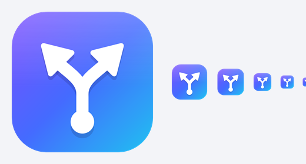
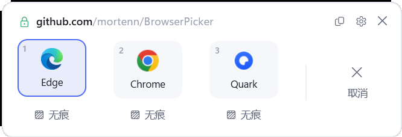
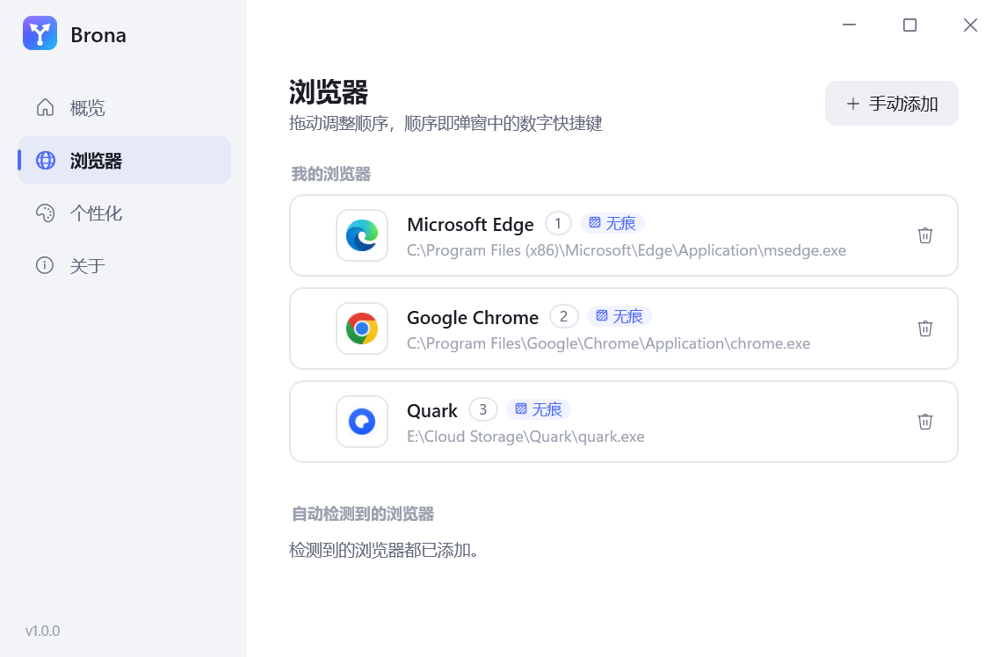
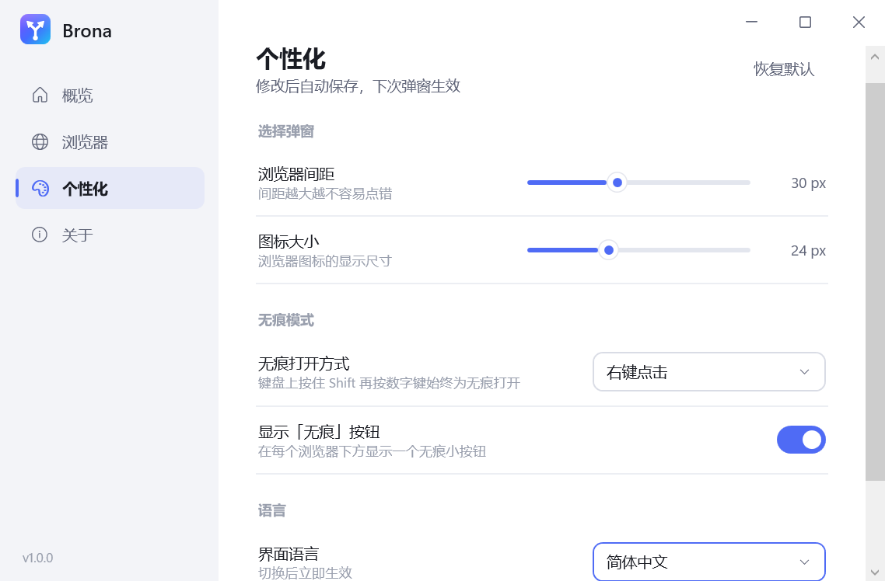

<div align="center">



# Brona

**点击链接时，先问一句：用哪个浏览器打开？**

一个轻量的 Windows 浏览器选择器：把 Brona 设为默认浏览器后，在任何软件里点链接，屏幕中央都会弹出一个小窗口，让你选 Edge、Chrome、Firefox……点错了可以直接取消。

简体中文 · [English](#english)

</div>

---

## 截图

<p align="center"></p>

| 我的浏览器（拖拽排序） | 个性化 |
| --- | --- |
|  |  |

## 功能

- **点链接先选浏览器**：Windows 原生程序（C# / WPF / .NET 10），约 0.6 秒弹出，选完立即退出，不常驻后台。
- **随时取消**：「取消」按钮、`Esc`、点弹窗外部都会直接关闭，不打开任何浏览器；弹窗刚出现的 0.3 秒内忽略鼠标点击，防止双击链接误触。
- **无痕模式**：每个浏览器下方有「无痕」按钮；也可以设置为 **右键 / Ctrl + 左键 / Shift + 左键** 无痕打开，键盘 `Shift + 数字` 始终为无痕。自动识别 Edge（`--inprivate`）、Firefox 系（`-private-window`）、Opera（`--private`）、Chromium 内核（`--incognito`）。
- **浏览器由你决定**：自动检测已安装的浏览器作为候选，可手动添加任意浏览器 exe，**拖拽排序**，顺序即数字快捷键。
- **个性化**：浏览器间距、图标大小可调；跟随系统深浅色。
- **40 种界面语言**：跟随系统或手动切换，立即生效；阿拉伯语、希伯来语、波斯语、乌尔都语自动从右到左排版。
- **安全**：只接受 `http` / `https` 链接和本地网页文件，拒绝 `javascript:` 等协议；链接规范化转义后再交给浏览器，无法注入命令行参数；只写当前用户注册表，无需管理员权限。
- **无缓存**：唯一写入的文件是 `%AppData%\Brona\browsers.json`（浏览器列表和个性化设置），取消注册时一并删除。

## 快捷键（弹窗中）

| 按键 | 作用 |
| --- | --- |
| `1`–`9` | 用对应序号的浏览器打开 |
| `Shift` + `1`–`9` | 无痕打开 |
| `←` `→` / `Tab` | 切换选中项 |
| `Enter` / `Shift + Enter` | 打开 / 无痕打开选中的浏览器 |
| `Esc` | 取消 |
| `Ctrl + C` | 复制链接 |

## 安装

需要 [.NET 10 桌面运行时](https://dotnet.microsoft.com/download/dotnet/10.0)（构建需要 .NET 10 SDK）。

**一键安装（从源码）**：在仓库根目录运行

```powershell
pwsh ./install.ps1
```

脚本会编译并安装到 `%LocalAppData%\Programs\Brona`、注册到系统，然后打开 Windows「默认应用」设置。在 Brona 页面点击 **「设为默认值」** 即完成——Windows 10/11 不允许程序自己修改默认浏览器，这一步必须手动确认。

**手动构建**：

```powershell
dotnet publish src/Brona/Brona.csproj -c Release -o dist
```

命令行参数：`Brona.exe --register` 注册、`Brona.exe --unregister` 取消注册、`Brona.exe <链接>` 弹出选择窗口、不带参数打开设置。

**卸载**：设置 →「关于」→「取消注册」，然后删除程序文件夹。

## 与同类项目对比

| 功能 | **Brona** | [BrowserPicker](https://github.com/mortenn/BrowserPicker) | [BrowserSelect](https://github.com/zumoshi/BrowserSelect) | [linkquisition](https://github.com/Strobotti/linkquisition) |
| --- | --- | --- | --- | --- |
| 平台 | Windows | Windows | Windows | Linux / macOS / Windows |
| 中文界面 | ✅（共 40 种语言） | 社区分支 | — | 多语言 |
| 自动检测浏览器 | ✅ | ✅ | ✅ | ✅ |
| 无痕打开 | ✅ 按钮 / 右键 / Ctrl / Shift 可选 | — | ✅ | ✅ |
| 拖拽排序 | ✅ | — | — | — |
| 按网址规则自动选择 | 规划中 | ✅ | ✅ | ✅ |
| 浏览器多用户配置 | 规划中 | ✅ | — | ✅ |
| 按使用频率排序 | 规划中 | ✅ | — | — |
| 链接安全检查 / 二维码 | 规划中 | — | — | ✅ |

> 「—」表示该项目 README 中没有提及，不代表一定不支持。

## 路线图

按优先级排列，欢迎在 Issue 中讨论：

1. **网址规则**：按域名 / 通配符 / 正则自动用指定浏览器打开；弹窗中加「记住此网站的选择」。
2. **浏览器多用户配置**：Chrome / Edge / Firefox 的多个配置（如「工作」「个人」）作为独立选项。
3. **链接清洗**：去除 `utm_*` 等跟踪参数；展开 Outlook SafeLinks 以及 QQ、微信等的中间跳转页。
4. **来源程序识别**：按点击链接的程序（微信、钉钉、飞书……）设定默认浏览器。
5. **商店版浏览器检测**：通过系统接口列出能打开链接的所有程序，覆盖微软商店安装的浏览器。
6. **按使用频率排序**（可选）、记住上次选择。
7. **链接安全检查与二维码**：一键用手机扫码打开。
8. **更快弹出**：可选的托盘常驻预热、开机自启。
9. **分发**：安装包、winget / Scoop、自动更新。
10. **外观**：手动深浅色切换、自定义主题色。

## 参与翻译

界面文字位于 [`src/Brona/Strings`](src/Brona/Strings)，每种语言一个 JSON 文件，缺失的条目会自动使用英文。新增语言：复制 `en.json` 改名翻译，并在 [`Loc.cs`](src/Brona/Services/Loc.cs) 的 `Supported` 列表中登记。

> 除简体中文和英文外，其余语言为 AI 翻译，未经母语者校对，欢迎提 PR 改进。

## 目录结构

```
src/Brona/
├─ App.xaml(.cs)                 入口：带链接参数显示选择弹窗，否则显示设置窗口
├─ Views/PickerWindow            选择弹窗
├─ Views/SettingsWindow          设置窗口（概览 / 浏览器 / 个性化 / 关于）
├─ Services/BrowserDetector      自动检测浏览器、识别无痕参数
├─ Services/BrowserLauncher      链接校验与安全启动
├─ Services/ConfigStore          用户配置读写
├─ Services/RegistrationService  注册 / 取消注册为系统浏览器
├─ Services/Loc                  多语言
├─ Strings/                      40 种语言文件
└─ Themes/                       浅色 / 深色配色与控件样式
tools/make-icon.ps1              生成程序图标
install.ps1                      一键编译、安装、注册
```

## 许可证

[MIT](LICENSE)

---

<a id="english"></a>

## English

**Brona** is a lightweight browser picker for Windows. Set it as your default browser, and every link you click — in any app — pops up a small window in the center of the screen asking which browser to use. Misclicked? Just cancel.

- Native and fast (C# / WPF / .NET 10), exits right after you choose
- Cancel with the button, `Esc`, or by clicking outside
- Private mode: a Private button under each browser, or right-click / Ctrl+click / Shift+click (configurable); `Shift + number` always opens privately
- Auto-detects installed browsers, add any browser manually, drag to reorder
- Adjustable spacing and icon size, light/dark theme
- 40 interface languages with right-to-left support
- Safe: only `http`/`https` links and local web pages; per-user registration, no admin rights; no caches

Install from source: `pwsh ./install.ps1`, then click **Set default** on Brona's page in Windows Settings.
